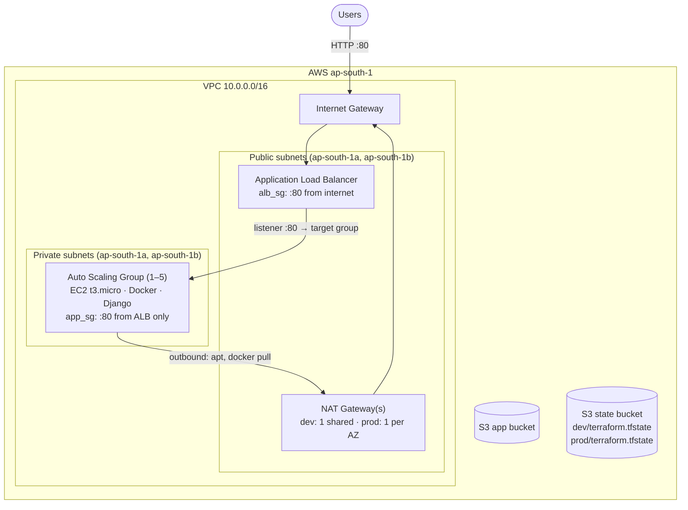
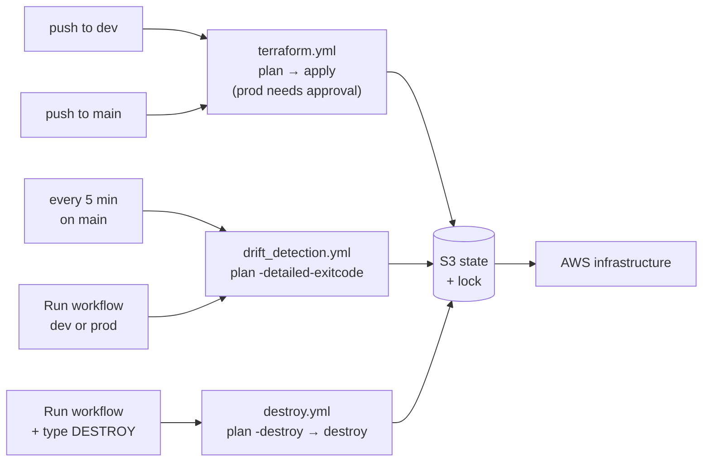

# Terraform Drift Detection & Auto-Remediation with GitHub Actions

Infrastructure on AWS is managed by Terraform and deployed through GitHub Actions. A scheduled
workflow keeps checking that the real infrastructure still matches the code. When someone changes
something by hand (for example, opens SSH to the internet in the console), the change is **detected,
recorded as a GitHub Issue, and automatically reverted**.


---

## What is drift?

Terraform code describes what the infrastructure **should** look like. **Drift** is when the real
infrastructure no longer matches it: a manual console change, a script, or another tool modified a
resource outside Terraform. Drift is dangerous because the change was never reviewed, and the code
no longer tells the truth about what is running.

This project closes that gap:

```
someone adds SSH :22 from 0.0.0.0/0 in the console
        → scheduled drift check: terraform plan -detailed-exitcode → exit code 2 (drift)
        → GitHub Issue "🚨 Terraform Drift Detected [prod]" with the plan
        → terraform apply → the rule is removed
        → issue commented and closed (+ optional Slack message)
```

---

## Architecture

Each environment (dev and prod) gets its own copy of this stack:



| Component | Purpose |
|---|---|
| VPC, 2 public + 2 private subnets | Network across two availability zones |
| Internet Gateway | Internet access for the public subnets |
| NAT Gateway(s) | Outbound-only internet for private instances. **dev: 1 (cheaper), prod: 1 per AZ (survives an AZ failure)** |
| Application Load Balancer | The only public entry point; forwards to healthy instances |
| Auto Scaling Group + Launch Template | 1–5 Ubuntu instances in private subnets, CPU target-tracking at 70% |
| Security groups | ALB accepts :80 from the internet; instances accept :80 **only from the ALB** |
| S3 app bucket | Versioned, encrypted, ACLs disabled, public access blocked |
| S3 state bucket | Remote state for both environments, with S3-native locking (`use_lockfile`) |

---

## CI/CD and drift flow



**Branch = environment.** The same code deploys both environments; the branch decides which state
file and which `environment` value are used:

| Branch | Environment | Backend config | State file | Approval |
|---|---|---|---|---|
| `dev` | dev | `backend-dev.hcl` | `dev/terraform.tfstate` | none |
| `main` | prod | `backend-prod.hcl` | `prod/terraform.tfstate` | required reviewer |

Changes are made on `dev`, verified there, then merged into `main` to deploy prod.

### Drift detection logic

| `terraform plan -detailed-exitcode` | Meaning | Action |
|---|---|---|
| `0` | No drift | Close any open drift issue for that environment |
| `2` | Drift | Open (or comment on) an issue → `terraform apply` the saved plan → close the issue, or keep it open with an `auto-fix-failed` label if the fix fails |
| `1` | Error | Fail the run |
| — | State is empty (not deployed / destroyed) | **Skip** – otherwise "everything is missing" would be treated as drift and the whole environment would be rebuilt without approval |

---

## Repository structure

```
.
├── .github/workflows/
│   ├── terraform.yml          # CI/CD: plan on PR/push, apply on push (prod needs approval)
│   ├── drift_detection.yml    # Scheduled + manual drift check with auto-remediation
│   └── destroy.yml            # Manual teardown of one environment (type DESTROY)
├── bootstrap/                 # Creates the S3 state bucket (local state, run once)
│   ├── main.tf
│   ├── variables.tf
│   └── outputs.tf
├── backend.tf                 # Empty S3 backend – filled from backend-<env>.hcl at init
├── backend-dev.hcl            # key = dev/terraform.tfstate
├── backend-prod.hcl           # key = prod/terraform.tfstate
├── main.tf                    # Providers, default tags, Ubuntu AMI lookup
├── variables.tf               # Inputs (environment must be dev or prod)
├── vpc.tf                     # VPC, subnets, IGW, NAT, routes
├── security_groups.tf         # ALB and app security groups (inline rules)
├── alb.tf                     # Load balancer, target group, listener
├── asg.tf                     # Launch template, Auto Scaling Group, scaling policy
├── s3.tf                      # Application bucket
├── outputs.tf                 # ALB URL, IDs, NAT IPs
└── scripts/user_data.sh       # Installs Docker and runs the app container
```

---

## Setup

### Prerequisites
- AWS account and an IAM user with permissions for EC2, VPC, ELB, Auto Scaling, CloudWatch and S3
- Terraform `>= 1.10` (S3-native state locking) and the AWS CLI configured locally
- A GitHub repository with Actions enabled

### 1. Create the state bucket
Set a globally unique name in `bootstrap/variables.tf`, then:
```bash
cd bootstrap
terraform init
terraform apply
```
Use the same bucket name and region in `backend-dev.hcl` and `backend-prod.hcl`.
Keep `bootstrap/terraform.tfstate` safe – it is git-ignored on purpose.

### 2. Configure GitHub
**Settings → Secrets and variables → Actions → Repository secrets**

| Secret | Required |
|---|---|
| `AWS_ACCESS_KEY_ID` | yes |
| `AWS_SECRET_ACCESS_KEY` | yes |
| `SLACK_WEBHOOK_URL` | optional – Slack steps are skipped without it |

**Settings → Environments:** create `dev`, and `prod` with yourself as a **required reviewer**.

### 3. Deploy
```bash
git push origin main          # main must exist first: it is the default branch, and schedules only run there
git push origin dev           # deploys dev
# test on dev, then promote:
git checkout main && git merge dev && git push origin main   # deploys prod after approval
```

### Run locally (optional)
```bash
terraform init -backend-config=backend-dev.hcl
terraform plan -var="environment=dev"
```

---

## Testing drift

1. Open **EC2 → Security Groups → `<env>-alb-sg`** and add an inbound rule: SSH, port 22, `0.0.0.0/0`.
2. Wait for the scheduled check (prod), or run **Actions → Terraform Drift Detection → Run workflow** and pick the environment.
3. Watch the run: plan exits with `2`, an issue opens with the plan, `apply` removes the rule, the issue closes.
4. Refresh the security group – only the port 80 rule is left.

Other drift to try: delete or change a tag on a resource, or change a target group health-check setting.

---

## Design decisions and fixes to the reference code

| Area | Change | Why |
|---|---|---|
| Region | `us-east-1` → `ap-south-1`, AMI looked up with a `data` source | Hard-coded AMI IDs only exist in one region and go stale |
| Environments | `environment` has no default and must be `dev` or `prod`; passed as `TF_VAR_environment` | The reference deployed both environments as "production" |
| Naming | ALB, target group, ASG, security groups and policies are prefixed with the environment | These names must be unique per account/region – dev and prod would collide |
| NAT | 1 for dev, 1 per AZ for prod (`local.nat_gateway_count`) | Cost vs availability |
| Boot race | ASG `depends_on` the private NAT routes | Instances could boot before the NAT route existed, so `user_data` failed to install Docker (found while testing dev) |
| Security groups | Rules kept **inline**; removed SSH-from-anywhere, unused 443 and deprecated groups | Inline rules let Terraform own the full rule set, so a manually added rule is detected as drift |
| Autoscaling | One target-tracking policy; `ignore_changes = [desired_capacity]` | Mixed policies could fight each other; without `ignore_changes`, every scale-in would be "drift" and get undone |
| Workflows | `set -o pipefail` around `tee` | Failed plans/destroys were reported as success |
| Workflows | Shared `concurrency` group per environment | A drift check never runs against a half-finished deploy, and runs never fight over the state lock |
| Drift | Skip when state is empty; issues filtered per environment; failed fixes keep the issue open and fail the run; apply the exact saved plan | Avoids unapproved rebuilds, wrong issue closures and silent failures |
| Destroy | Disables the scheduled drift workflow before destroying prod | Otherwise the next drift check would rebuild the destroyed environment |
| S3 | `BucketOwnerEnforced` (no ACLs), `force_destroy` on the app bucket | Current AWS recommendation; lets the destroy workflow finish |

---

## Cost

Approximate cost in `ap-south-1` while running (both environments): **~$7–9 per day**, mostly NAT
gateways (3 in total) and the two load balancers. Destroy the environments when you are done.

GitHub Actions minutes are free on public repositories. On a private repository, a 5-minute
schedule uses roughly 300 minutes per day – change the cron to daily (`0 8 * * *`) or disable the
drift workflow when it is not needed.

---

## Cleanup

1. **Actions → Terraform Destroy → Run workflow** → `dev`, type `DESTROY`
2. Same for `prod` (needs approval). This also disables the scheduled drift workflow – re-enable it in the Actions tab if you redeploy prod.
3. When completely finished, delete the state bucket. It has `prevent_destroy`, so remove that
   line from `bootstrap/main.tf` first, then empty the bucket (including all object versions) and
   run `terraform destroy` in `bootstrap/`.

---

## Troubleshooting

| Symptom | Cause / fix |
|---|---|
| ALB returns `502`, targets unhealthy | Check the instance boot log: **EC2 → Instance → Actions → Monitor → Get system log**. `apt-get` timeouts mean no route to the NAT gateway. |
| `Error acquiring the state lock` | Another run is using the same environment. Wait for it; only remove `<env>/terraform.tfstate.tflock` from S3 if you are sure nothing is running. |
| Scheduled drift check never runs | Schedules only run on the default branch, can start late, and GitHub disables them after 60 days without repository activity. |
| Drift run shows "skipped" | The environment's state is empty – deploy it first. |
| Slack step skipped | `SLACK_WEBHOOK_URL` must be a **repository** secret with that exact name. |

---

## Credits

- Course and reference project: **30 Days of AWS Terraform** by Piyush Sachdeva (Day 30)
- Demo application image: [`itsbaivab/django-app`](https://hub.docker.com/r/itsbaivab/django-app)

Built by [@trupti-vibhute](https://github.com/trupti-vibhute).